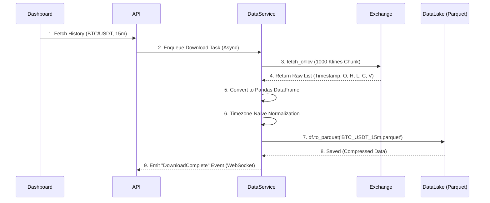

# 🔬 Technical Docs: Data Lab & Parquet Data Lake

AlgoBot v4.1.0'ın kalbi niteliğindeki devrimsel mimari yeniliği olan veri laboratuvarı (Data Lab) ve "Hybrid Data Engine" yapısının en temel bileşeni **Apache Parquet Data Lake**'dir.

Veri yönetimindeki en büyük performans artışı, eski sistemlerde kronik dar boğaz (I/O Bottleneck) olan SQLite veritabanı okuma/yazma döngülerinin "saf veri akış" (Stream) mimarisine dönüştürülmesidir.

## 1. Mimaride Neden Değişikliğe Gidildi? (SQLite vs. Parquet)

Eski sistemlerde tüm geçmiş fiyat barları (1 dakikalık yüzbinlerce mum) tek bir SQLite dosyasında (`cryptobot.db`) tutuluyordu.

**Eski Problemler (SQLite Limitasyonları):**
- **Sıralı Disk Erişimi (Row-Based Storage):** Veriler SQLite'da satır satır tutulur. Makine Öğrenmesi (ML) veya Strateji Motoru gibi "sütun bazlı" (Column-Oriented) hesaplamalar yapan (`RSI`, `SMA` vb. Pandas vektörel operasyonları) sistemler için verinin satır satır okunup RAM'de bir Pandas DataFrame'e çevrilmesi **devasa bir gecikmeye (Latency)** ve işlemci israfına yol açıyordu.
- **Database is Locked (Concurrency Sorunu):** Bot canlı işlemlere devam ederken arka planda WFO (Walk Forward Optimization) veya devasa geriye dönük test (Backtest) veri çektiğinde (ya da veri indirdiğinde) veritabanı kilitleniyor, canlı emirlerin borsaya iletilmesi sekteye uğruyordu.
- **Dosya Büyümesi:** SQLite dosyaları büyüdükçe performansları logaritmik olarak düşer.

**Yeni Çözüm (Parquet Data Lake):**
1. Tüm "Soğuk" (Geçmiş) ve "Ilık" (Analiz edilen) veriler, Apache Hadoop/Spark dünyasının endüstri standardı olan yüksek sıkıştırma oranına sahip **.parquet** dosyalarında saklanır.
2. Parquet, "Sütun Tabanlı" (Columnar) olduğu için (Örneğin sadece kapanış fiyatlarına ihtiyaç duyulursa `Close` sütununu) RAM'e saniyede gigabaytlarca hızda aktarır. **SQLite'a kıyasla ~500 Kat Hız Artışı sağlanmıştır.**
3. SQLite artık sadece "Sıcak" (Hot) anlık durumlar için (Emir durumu, Config, vb.) bir State Machine (Durum Makinesi) olarak kullanılır.

## 2. Veri İndirme ve İşleme Akışı (Data Pipeline)

Dashboard üzerinden veya kod içinden "Data Lab" aracı kullanıldığında süreç aşağıdaki Event-Driven akışı izler:

### Özellikler ve Bütünlük (Data Integrity Check):
- **Zaman Dilimi (Timezone Naive):** Pandas "Timezone Collision" (Tz-Aware vs Tz-Naive çakışmaları) hatalarını engellemek için tüm veriler Parquet'e yazılmadan önce **Timezone-Naive** (tz_convert(None) veya tz_localize(None)) standart formata çevrilir.
- **Bütünlük Kontrolü:** İndirilen ve birleştirilen DataFrame içinde "Gap" (Kayıp Mum/Boşluk) olup olmadığı kontrol edilir, gerekiyorsa (0 hacimli) "Dummy" mumlarla zaman serisi sürekliliği (Time-Series Continuity) sağlanır.
- **Performans Optimizasyonu:** `database_manager.cleanup_invalid_download_tasks()` fonksiyonu sayesinde "SEÇİNİZ" veya geçersiz sembol içeren görevler $O(1)$ toplu silme (Bulk Delete) mantığıyla N+1 Query döngülerine girmeden temizlenir.

## 3. Dependency-Free (Bağımlılıksız) Teknik İndikatörler

Data Lab sadece veri tutmaz, stratejiler ve ML Motoru için gerekli "Features" (İndikatörler) hesaplamalarını da üstlenir.

**Kritik Yenilik (%100 Saf Pandas/Numpy):**
Ubuntu sistemlerinde `pandas-ta` kütüphanesinin C derleyici kaynaklı (Build-Essential) kurulum hataları sebebiyle **`pandas-ta` projeden tamamen sökülmüştür.**

Bunun yerine, tüm indikatör hesaplamaları (RSI, MACD, Bollinger, ATR vb.) `data/indicators/` dizini altındaki modüllerde **sadece saf Pandas ve Numpy vektörel işlemleri** ile yazılmıştır.

*   Vektörel Hesaplama: DataFrame içinde satır satır (`for` döngüsü) gezinmek yerine (bu çok yavaştır), tüm sütun aynı anda (Örn: `df['close'].rolling(14).mean()`) hesaplanarak milisaniyenin altında sonuç üretilir.
*   Bu "bağımsızlık", sunucuya tek tıkla kurulum (`start_ubuntu_pro.sh`) imkanı sağlamış ve kütüphane çakışmalarını tarihe gömmüştür.
