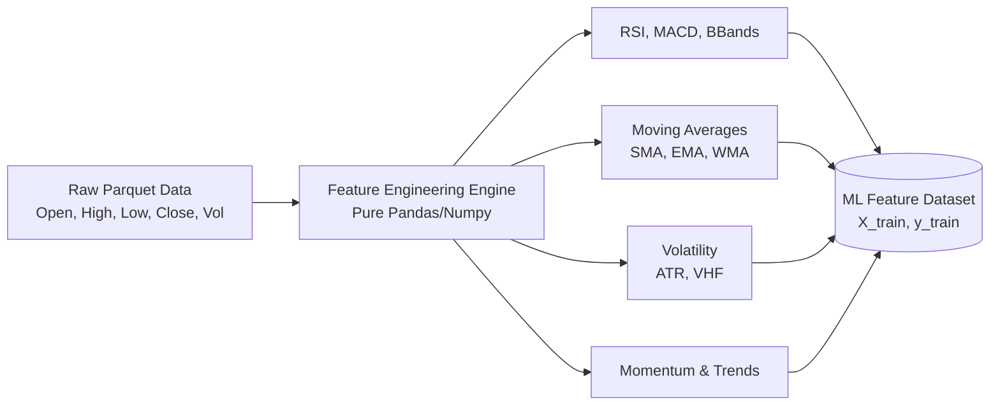
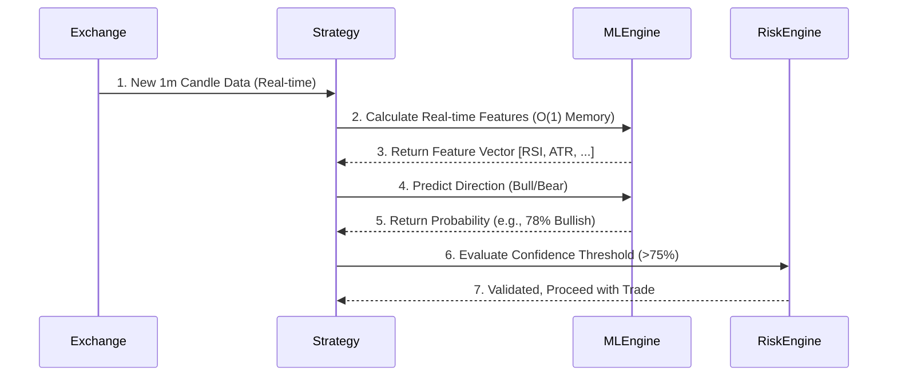

# 🧠 Technical Docs: ML Engine & Tahmin Döngüsü (Prediction Pipeline)

AlgoBot v4.1.0'ın "Beyni" olarak adlandırılan Makine Öğrenmesi (ML) Motoru, fiyat hareketlerini önceden tahmin etmek ve stratejilerin alacağı kararları optimize etmek için **XGBoost (Extreme Gradient Boosting)** tabanlı, Parquet veri gölü (Data Lake) entegrasyonlu bir tahmine dayalı altyapıdır.

## 1. Veri Hazırlığı ve Feature Engineering (Özellik Mühendisliği)

Veri kalitesi, ML modelinin başarısındaki en kritik faktördür.
AlgoBot, tahmin yeteneğini maksimize etmek için ham fiyat verilerini (Klines/OHLCV) doğrudan modele vermez. Bunun yerine, bu verilerden türetilmiş matematiksel göstergeleri (Features) oluşturur.

**Temel Özellik Seti (Features):**
- **Trend Göstergeleri:** `SMA_20`, `EMA_50`, MACD Histogram vb.
- **Momentum:** `RSI_14`, Stochastic Oscillator vb.
- **Volatilite:** `ATR_14`, Bollinger Bands genişliği vb.
- **Formasyonlar ve Hacim:** Hacim profili, MFI (Money Flow Index).

> ⚠️ **Uyarı (Dependency-Free):** Feature Engineering sürecinde `pandas-ta` gibi dış kütüphaneler **asla** kullanılmaz. Tüm hesaplamalar, uyumluluk ve stabilite (Ubuntu C-derleyici hatalarından kaçınmak) için sadece **saf Pandas ve Numpy vektörel operasyonları** ile hesaplanır (`data/indicators/` modülleri).

## 2. Model Eğitimi (Model Training Lifecycle)

Eğitim süreci, **Event-Driven Architecture** içinde izole bir arka plan görevi (Background Task) olarak asenkron (`asyncio.to_thread`) çalışır. Bu sayede model eğitilirken bot canlı ticareti (Live Trading) kesintiye uğratmaz.

### 2.1 Veri Okuma (Parquet Lake)
Model eğitimi başlatıldığında sistem SQLite'ı devre dışı bırakır. Sütun tabanlı ve yüksek performanslı **Apache Parquet Data Lake** (`data/data_lake.py`) üzerinden devasa boyutlardaki tarihsel veriler milisaniyeler içinde RAM'e (Pandas DataFrame) çekilir.

### 2.2 Veri Ön İşleme (Preprocessing)
1. **NaN Temizliği:** Eksik veriler (örn. EMA hesaplanana kadar geçen ilk N mum) ileriye dönük sızıntı (Data Leakage) olmaması için titizlikle temizlenir (`dropna`, `ffill`).
2. **Normalizasyon (Scaling):** XGBoost ağaç tabanlı bir algoritma olduğu için zorunlu olmasa da, diğer istatistiksel işlemler için `StandardScaler` veya `MinMaxScaler` uygulanır.
3. **Hedef (Target) Belirleme:** Model neyi tahmin edecek? Varsayılan hedef, "N mum sonrasındaki kapanış fiyatı (Close) anlık fiyattan yüksek mi düşük mü?" (Binary Classification: Yön Tahmini).

### 2.3 XGBoost Modeli
Eğitim aşamasında **XGBClassifier** veya **XGBRegressor** kullanılır.
Eğitim hiperparametreleri (Learning Rate, Max Depth, N-Estimators vb.) `ml/` dizinindeki yapılandırma üzerinden dinamik olarak veya MLOps standartlarına uygun **Bayesian Optimization** ile optimize edilir.

## 3. Tahmin Döngüsü ve Canlı İşlem (Prediction & Live Execution)

Eğitilen model diske kaydedilir (Güvenlik gereği asla `pickle` kullanılmaz, model `.json` formatında kaydedilir ve metadata'lar ayrı bir JSON'da tutulur).

Tahmin döngüsünde (Prediction Pipeline), sisteme gelen yeni her bir mum (Kline), sadece son satır (veya gerekli lookback penceresi) kadar işlenir ve XGBoost modeline sunulur. Eğer model, işlemin başarılı olacağına dair bir "Confidence Score" (Güven Skoru) (örneğin `%75` üzeri) üretirse, strateji bu sinyali onaylar.

Bu ML tabanlı filtreleme mekanizması, geleneksel indikatör tabanlı sistemlerin **yanlış kırılım (Fakeout) veya zayıf trendlerde (Chop Market)** gereksiz yere işleme girmesini büyük oranda engeller.
